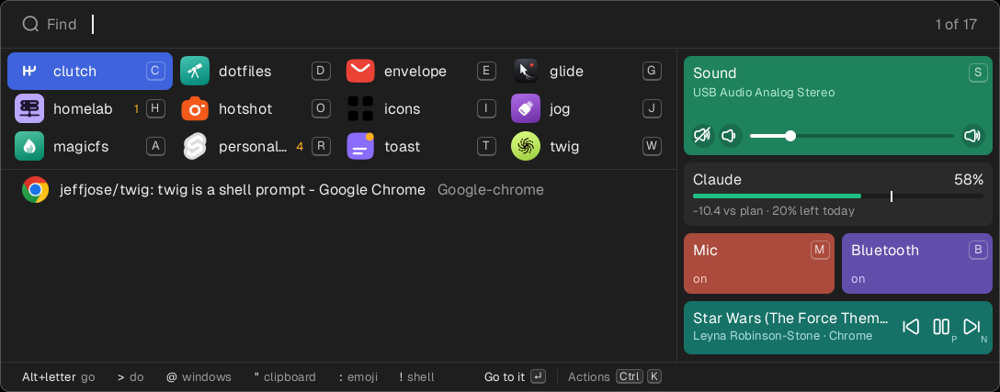
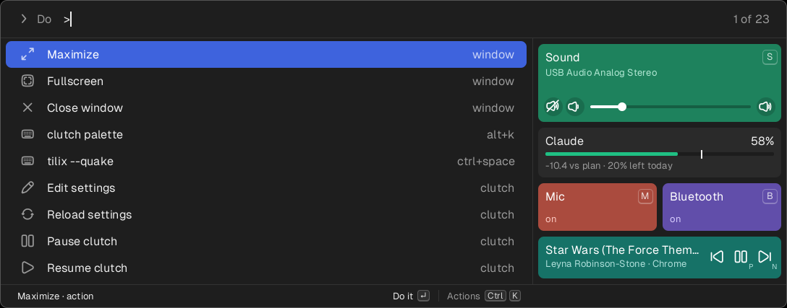
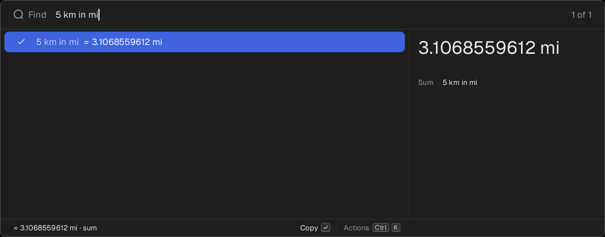
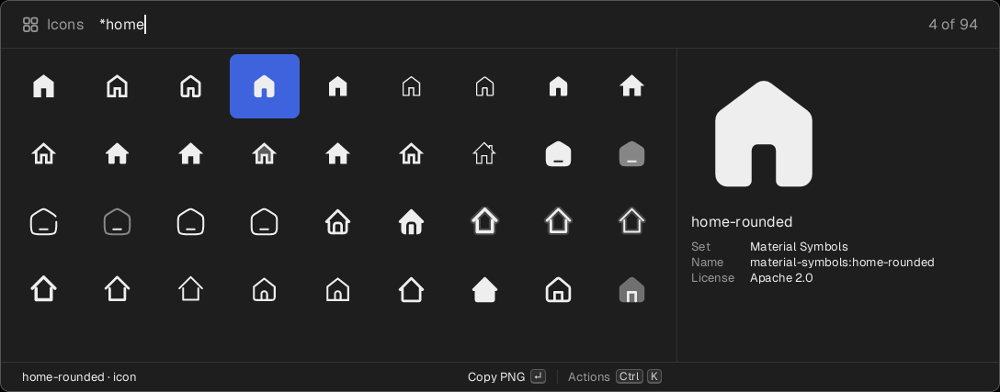
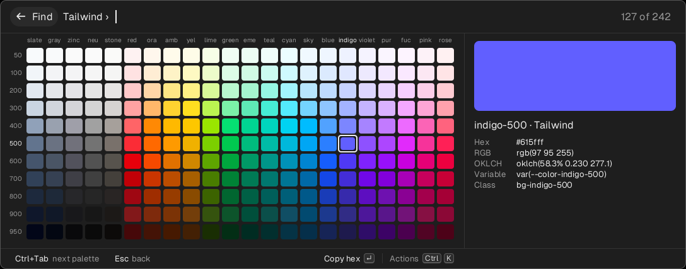
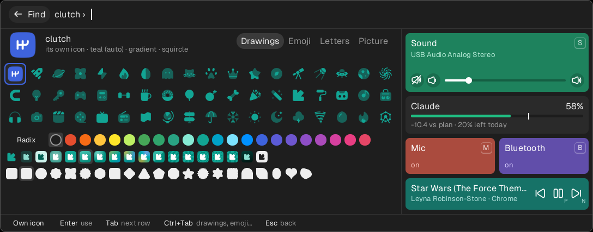
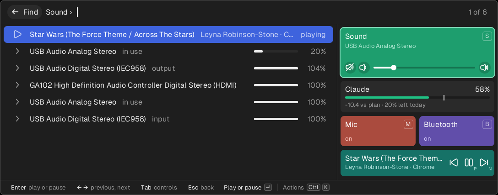

# clutch

Global key bindings that take priority over every program. clutch grabs
the keyboards, reads every key, and passes all of them through except
the ones you have bound, which run a command instead. It works below the
desktop, so the same settings apply on X11, on Wayland and on the
console, regardless of the desktop's own shortcuts.

```toml
[bind]
"ctrl+space"    = "tilix --quake"
"print"         = "hotshot"
"super+space t" = "xterm"        # Super+Space, then T
```

## Install

```sh
cargo install --git https://github.com/jeffjose/clutch
clutch setup
```

`clutch setup` asks for sudo once, to install a udev rule that lets the
logged-in user read the machine's keyboards. It then writes
`~/.config/clutch/config.toml`, which binds only Alt+K, to the box, and
starts clutch as a systemd user service. Nothing runs as root.

## Use

```sh
clutch status    # show what is running, which keyboards it holds, and what is bound
clutch pause     # release the keyboards until `clutch resume`
clutch check     # read the settings and report any problems
clutch remove    # uninstall clutch from this machine
```

The settings are reloaded whenever the file is saved. If the file has a
mistake, the existing bindings stay in effect. A key is written with its
modifiers (`ctrl`, `shift`, `alt`, `super`). For a sequence, write the
keys in order with a space between them.

A key that clutch handles is not seen by anything else. A desktop
shortcut on the same key does nothing while clutch is running, and works
again when it isn't.

## The box



```toml
"alt+k" = "clutch palette"
```

The box is a command palette. Type to list the matching windows and
applications, and press Enter to switch to the selected one. With
nothing typed, it lists your windows with the previously used one first,
so the shortcut followed by Enter switches back to it. A prefix narrows
what is searched:

| | |
|---|---|
| `>` | actions: move the front window to the next monitor, maximize or close it, send it to a workspace; run a binding; pause clutch |
| `@` | windows only |
| `#` | workspaces |
| `!` | a shell command |
| `"` | clipboard history, numbered from the newest: `"3` is the third; Enter copies it again, Alt+3 at once. The side shows the one picked out whole |
| `:` | emoji by name; Enter copies one |
| `*` | icons, looked up on Iconify as you type: `*home`, or `*lucide:arrow` in one set. Enter copies one as a PNG |



Some things typed are answered first, above everything else:

- a sum or a conversion: `12*7`, `sqrt(2)`, `5 km in mi`, `350f in c`, `2.5 gb in mb`. Enter copies the answer.
- a web address: `youtube.com` opens it in a new tab of your browser.
- a search from `[links]` in the settings, as the word, a slash and what to look for: `g/rust lifetimes` searches Google, `gh/clutch` GitHub, `yt/…` YouTube. The settings list more, commented out. A link without `{}` opens as it is, and what matches nothing is offered to `g`.
- a color by its name: `blue-500`, in each palette that has one so called. `#3b82f6` is the nearest in each palette. Enter copies the hex.
- a timer: `timer 25m tea`, `timer 1h30m`, `timer 10` (minutes). When it is done the desktop says so, with a sound. Timers that are running are listed under the projects, counting down; Enter on one stops it.



The clipboard history is kept by the running clutch, in
`~/.local/state/clutch/clipboard` (the last 100 copies, readable only by
you). What a password manager marks as a secret is not kept. It needs
`xclip` on X11; on Wayland it asks `wl-paste`, where that works.



Icons come from [Iconify](https://iconify.design)'s 200-odd sets, fetched
as they are found, so nothing of them is carried. Enter copies the one
picked out as a PNG, black on clear and 256 pixels square; Ctrl+K copies
its SVG or its name instead, or opens its page. What has been fetched is
kept in `~/.cache/clutch/icons`. It needs `curl`.



Type `tailwind`, `radix`, `material` or `chakra` and Enter shows that
palette's colors, a column for each hue and a row for each shade.
Typing narrows the hues; Ctrl+Tab goes to the next palette. Enter or a
click copies a color's hex, and Ctrl+K its RGB, OKLCH, CSS variable or
Tailwind class. The palette opens again on the color last copied from
it, marked with a dot, so the next of the same shade is an arrow away;
"Forget last pick", on the right button or Ctrl+K, lets it open as it
comes. Bound to a key, `clutch palette tailwind` opens on the
colors straight away.

An editor window is treated as a coding project. With nothing typed, the
projects are shown as tiles, four across, each with an icon, the
project's name and its key. A tile also shows the number of changed
files when there are any, and the branch when it is not the main one.
None of this needs configuring: the project name comes from the
window's title, and the key is the first unused letter in the name.
Press Alt and the letter to jump straight to a project. For
example, clutch itself is `Alt+K`, then `Alt+C`: hold Alt and press K,
then C. A letter that is itself bound with Alt or Super, as K is here,
is not given to a project.

A project's icon is its own where its folder has one: a favicon, a file
named `icon` or `logo`, or one named after the project. Otherwise it is
a drawing on a colored background, chosen by the project's name so that
it stays the same. Icons are cached in `~/.cache/clutch/projects` and
looked for again after a day or when the file changes; `>Refresh project
icons` clears the cache. Icons other than PNG need ImageMagick.

Right-click a project, or press the Menu key, to change how it looks:
give it a color from the menu directly, shuffle its look, put back the
look it came with, or open "Icon and color…". There you choose what is
on its tile (one of 144 drawings, any emoji, two letters, its own icon
or a picture of your own; Ctrl+Tab goes between them, and typing
searches drawings and emoji by name), its color (from Radix's or
Tailwind's palette), its background
(eighteen, from a plain tint to rays and stripes) and its shape
(twenty-one). Looks are kept in `~/.config/clutch/looks.toml`. Choosing
a picture needs `zenity`; emoji need the Noto Color Emoji font and
Unicode's `emoji-test.txt`, which most distributions install.



Anything gone into (Wi-Fi, Sound, a project's look) has a "← Find"
button where the search was; Esc, or Backspace with nothing typed, goes
back too.

Ctrl+K on anything picked out lists everything that can be done to it,
and typing narrows the list: a project's look, its path, its page on
GitHub; a copy pasted into the window before (Ctrl+Enter, with
`xdotool`) or forgotten (Ctrl+D). Each action's keys work without the
list too. The foot of the box says what Enter will do. Up is Ctrl+P,
down Ctrl+N or Ctrl+J.

While you type, the side beside the list shows more of what is picked
out: a project's branch, last commit and changed files, an emoji large,
a sum in hex and binary, the command an application runs.

Every folder in `~/scripts` (and `~/code`, `~/src`, `~/projects`, `~/work`,
`~/dev`, `~/repos`, `~/git`) is a project: typing `drift` and Enter is
`code ~/scripts/drift`. A word that matches nothing offers "New project",
which makes the folder and opens it.

Projects that are not open are tiles too, more dimly, where a launcher
was made for the folder (a `.desktop` file whose `StartupWMClass` is
`code-` and the folder's path, as VS Code's own are named). Enter, a
click or Alt and its letter starts it.

Beside the list are the controls: sound, large, with its volume and
buttons to mute, go quieter and go louder; the microphone and
Bluetooth; Wi-Fi, on a laptop; and what is playing, along the foot.
Each has a letter: Alt and the letter flips it, with the box still up, so
`Alt+K` then `Alt+P` pauses whatever is playing (`S` mutes, `M`
microphone, `B` Bluetooth, `W` Wi-Fi, `P` play, `N` next). Those
letters are never given to projects.

The volume changes with the box still up: Alt+↑ and Alt+↓ anywhere in
it, the wheel over the Sound tile, its buttons, or a click on its bar.
Tab moves to the controls; Space or a click flips one, and on Sound the
arrows across are the volume. A click on the rest of the Sound tile
goes into it, and so does Wi-Fi's →. Gone into, Wi-Fi and Sound list instead: the
networks to join or leave, and the devices with their levels, where the
left and right arrows change the volume, Enter makes a device the one
in use and Ctrl+M mutes it. Whatever is playing is listed first: Enter
plays or pauses it, and the arrows go to the previous or next track.
Esc goes back. The controls can also be
found by typing their names. They use `nmcli`, `pactl`, `busctl`, `bluetoothctl`,
and `gsettings` or `xfconf-query`; a control whose tool is missing says
"not here".



Two more commands are meant to be bound to keys of their own:

```sh
clutch raise firefox       # switch to Firefox's window, or start Firefox
clutch move-monitor        # move the front window to the next monitor
```

None of these commands need clutch to be running. They start, do one
thing and exit, so a desktop shortcut can run them too.

On X11, any program can list and move windows. On Wayland only the
desktop can, so on GNOME `clutch setup` also installs a small shell
extension. The extension lists and moves windows for clutch, and centers
the box on screen with keyboard focus. It needs no sudo, but takes
effect after you log out and back in. Without it, and on other Wayland
desktops, the box offers only applications, bindings and shell commands.

## visor

visor is a drop-down terminal: Ghostty running `screen -dRR`, brought
in from an edge of the screen at a key and sent away again at the same
key.

```toml
[bind]
"ctrl+space" = "clutch visor"
"ctrl+shift+space" = "clutch palette '>visor'"
"ctrl+super+left" = "clutch visor left"
"ctrl+super+g" = "clutch visor grow"
```

`clutch visor` starts the terminal if there is none, brings it in if it
is away, gives it the keyboard if it is in but behind, and sends it away
if it is in and has the keyboard. The rest move it, and bring it in if
it is away:

```sh
clutch visor left              # to an edge: top, bottom, left, right, center
clutch visor right-third       # a shape: top-centered, left-half, right-half,
                               # right-third, corner, floating, peek
clutch visor bigger            # or smaller, by a tenth of the screen
clutch visor grow              # its next size: 40%, 70%, 100%, and round again
clutch visor full              # full screen, and back
clutch visor reset             # as the settings say
clutch visor status            # where it is, in a line
```

Where it was moved to is kept until the settings are saved again. In the
box, `>visor` lists its shapes, so Ctrl+Shift+Space, a word of the shape
and Enter puts it there. The settings say where it starts:

```toml
[visor]
shape = "top"            # or edge, width, height and align, each said
height = "40%"
gap = 0                  # pixels between it and the edges of the screen
grow = ["40%", "70%", "100%"]
monitor = "in use"       # where the pointer is, or "main"
slide = true             # on GNOME
hide_on_click_away = false
```

The example settings have them all. The terminal is known by its class,
`io.github.jeffjose.visor`, so it is a Ghostty of its own and your other
Ghostty windows are left alone; `run` says what starts it, for a
different terminal or a command other than screen. It stays above the
other windows and on every workspace, and is left out of the box's
windows. On X11 it is off the taskbar too, and comes in at once. On GNOME
the shell's extension moves it, which needs the extension as this clutch
writes it: run `clutch setup` once more and log out and in. It slides in
there, but it is still in the shell's Alt+Tab.

## Without sudo

If the udev rule can't be installed, clutch can't grab the keyboards. On
GNOME it registers your bindings as GNOME custom shortcuts instead, and
keeps them in sync with the settings file. The file and the commands
stay the same. `clutch status` shows which mode a machine is in, and
which bindings couldn't be carried over:

- Only chords are supported, because GNOME has no key sequences.
- A GNOME shortcut on the same keys takes priority. `clutch status`
  prints the command that clears it.

Shortcuts you created in GNOME yourself are left alone.

## If it goes wrong

clutch sits between you and every key, so there are three ways out:

- **Hold Backspace, Escape and Enter together** to stop it, whatever
  else is happening.
- If it stops responding, systemd kills it within five seconds.
- However it ends, the kernel returns the keyboards.

clutch reads every key you press and stores none of them. The only
thing it logs is which bindings ran.

## Not yet

- Tap versus hold, and layers.
- Keyboards that are also a mouse or a touchpad. These are left alone.
- Bindings still run while the screen is locked.

## Tests

```sh
cargo test                # the logic
cargo test -- --ignored   # clutch itself, between a virtual keyboard and
                          # a reader; needs `clutch setup` first
```

## License

MIT
