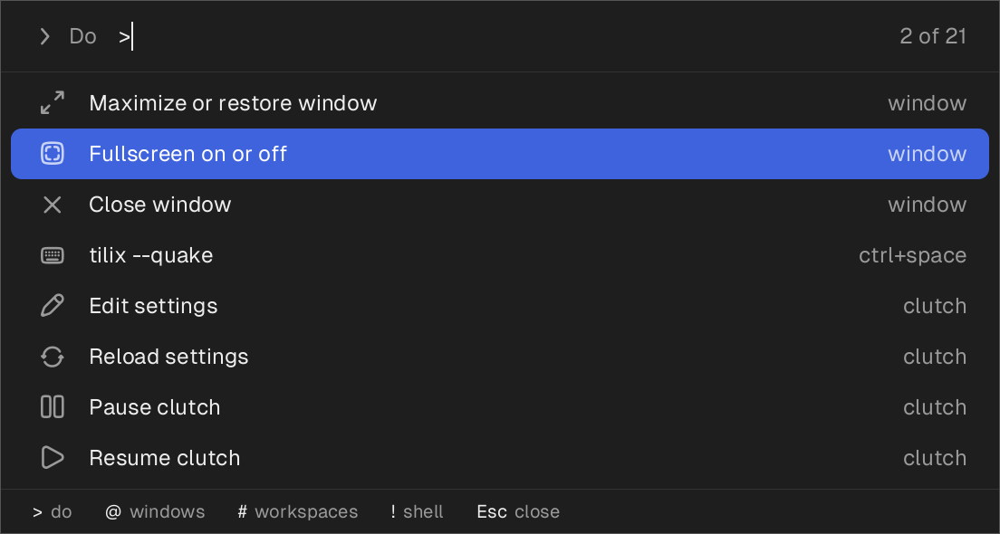

# clutch

Keys that are yours before any program's. clutch holds the keyboards,
reads every key, and passes on all but the ones you have bound, which
run a command instead. It sits below the desktop, so the same settings
work on X11, on Wayland and on the console, whatever the desktop's own
shortcuts say.

```toml
[bind]
"ctrl+space"    = "tilix --quake"
"print"         = "hotshot"
"super+space t" = "xterm"        # Super+Space, then T
```

## Install

```sh
cargo install --git https://github.com/jeffjose/clutch
clutch setup
```

`clutch setup` asks for sudo once, to put in a udev rule that lets
whoever is logged in at the machine read its keyboards. Then it writes
`~/.config/clutch/config.toml`, with nothing bound, and starts clutch as
a systemd user service. Nothing runs as root.

## Use

```sh
clutch status    # what is running, the keyboards it holds, what is bound
clutch pause     # give the keyboards back, until `clutch resume`
clutch check     # read the settings and say what is wrong with them
clutch remove    # take clutch off this machine
```

The settings are read again whenever the file is saved; a mistake in
them leaves the bindings as they were. A key is written with its
modifiers (`ctrl`, `shift`, `alt`, `super`), and keys pressed one after
another with a space between them.

A key clutch takes is not seen by anything else, so a shortcut of the
desktop's on the same key does nothing while clutch runs, and works
again when it does not.

## The box



```toml
"alt+space" = "clutch palette"
```

Type, and the windows and applications that match are listed; Enter
goes to the one picked out. With nothing typed it lists the windows, the
one used before this one first, so the key and Enter go back to it. The
first letter says what is looked for:

| | |
|---|---|
| `>` | things to do: move the window in front to the next monitor, maximize or close it, send it to a workspace; run a binding; pause clutch |
| `@` | windows only |
| `#` | workspaces |
| `!` | a line of shell |

Two more for keys of their own:

```sh
clutch raise firefox       # go to Firefox's window, or start it
clutch move-monitor        # the window in front, to the next monitor
```

None of these needs clutch running: they are programs that start, do
their one thing and are gone, so a shortcut of the desktop's can run
them as well.

On X11 any program can see and move the windows. On Wayland only the
desktop can, so on GNOME `clutch setup` also puts a small extension in
the shell, which lists and moves them for clutch and puts the box in
the middle of the screen with the keyboard. It needs no sudo, and one
logout to load. Without it, and on other Wayland desktops, the box has
the applications, the bindings and the shell.

## Without sudo

Where the rule cannot be put in, clutch cannot hold the keyboards. On
GNOME it gives your bindings to GNOME instead, as custom shortcuts of
GNOME's own, and keeps them in step with the settings file. The file
and the commands are the same; `clutch status` says which way a machine
is, and what did not carry over:

- chords only: GNOME has no sequences;
- a shortcut of GNOME's on the same keys wins, and `clutch status` gives
  the command that clears it.

Shortcuts you made in GNOME yourself are left alone.

## If it goes wrong

clutch is between you and every key, so there are three ways out:

- **Backspace, Escape and Enter held together** stop it, whatever else
  is going on.
- If it stops answering, systemd kills it within five seconds.
- However it ends, the kernel gives the keyboards back.

It reads every key you press and keeps none: nothing is written down
but which bindings ran.

## Not yet

Tap against hold, layers, and keyboards that are also a mouse or a
touchpad, which are left alone. Bindings run while the screen is locked.

## Tests

```sh
cargo test                # the logic
cargo test -- --ignored   # clutch itself, between a keyboard that is not
                          # real and a reader; needs `clutch setup` first
```

## License

MIT
